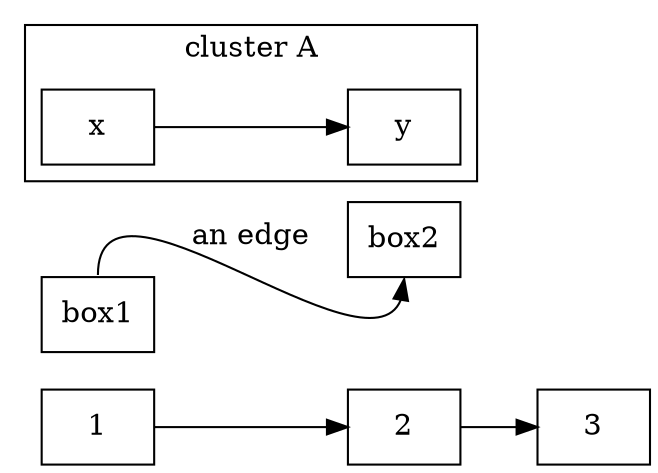

# dot

A language library built with [cursiv](https://github.com/ydaveluy/cursiv).

## Build

```bash
cmake -B build
cmake --build build -j
ctest --test-dir build --output-on-failure
```

The build generates the parser automatically. Rebuild after changing the grammar.

## What to edit

| What you want to change | File |
|---|---|
| The grammar | `src/dot/core/DotGrammar.hpp` |
| The AST | `src/dot/core/ast.hpp` |
| Validation checks | `src/dot/core/validation/` |
| Services of your own | `src/dot/core/CoreServices.hpp` + `CoreModule.cpp` |
| The command line | `src/dot/cli/main.cpp` |
| LSP features | `src/dot/lsp/LspModule.cpp` |
| Test cases | `tests/grammar_test.cpp` |

Generated files live under `build/src/generated-src/`; do not edit them.

## The sample

[Graphviz DOT](https://graphviz.org/doc/info/lang.html), the graph
description language:



A graph is a header (`strict`? and `graph`/`digraph`) and a brace-delimited
body of statements: nodes, edges, attribute assignments (`graph`/`node`/`edge`
`[...]`), plain assignments (`rankdir=LR`), and subgraphs, which nest.

## The command line

```bash
./build/src/dot_cli example/crazy.dot
./build/src/dot_cli --dump example/crazy.dot   # the syntax tree
```

The exit code is the verdict: 0 clean, 1 the document carries an error, 2 the
command was wrong, 3 something threw.

## The language server

`dot_lsp` speaks LSP over stdio. In VS Code, open this folder and
press **F5**: the task builds the server in the tree of the preset you have
selected -- `native` runs the host binary, `wasi` the wasm module -- and a
second window opens on `example/` with the extension loaded. The preset is
read through the CMake Tools extension, which the workspace recommends.

```bash
(cd vscode && npm install && npm run compile)
```
